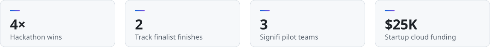

<a href="http://www.akshajnad.tech/">
  <picture>
    <source media="(prefers-color-scheme: dark)" srcset="assets/header-dark.svg">
    
  </picture>
</a>

  
  
  
  

 

I build applied AI systems across **cloud infrastructure**, **computer vision**, **robotics**, and **full-stack product development**.

My favorite projects move beyond a model demo. They connect the model to reliable backend workflows, clear interfaces, evaluation, and real users.

<picture>
  <source media="(prefers-color-scheme: dark)" srcset="assets/stats-dark.svg">
  
</picture>

## Current focus

<table>
  <tr>
    <td width="50%" valign="top">
      <h4>☁️&nbsp; Travelers</h4>
      Building AI-assisted support workflows with AWS Bedrock and serverless infrastructure
    </td>
    <td width="50%" valign="top">
      <h4>🧩&nbsp; <a href="https://www.signifi.tech/">Signifi</a></h4>
      Building a requirements platform that turns raw notes into linked product specs, user stories, test cases, and interactive prototypes
    </td>
  </tr>
  <tr>
    <td width="50%" valign="top">
      <h4>💬&nbsp; Graption</h4>
      Leading a speaker-aware live-captioning platform with a 15-person Georgia Tech team
    </td>
    <td width="50%" valign="top">
      <h4>🛰️&nbsp; Research</h4>
      Researching multi-agent spacecraft autonomy with ROS2, MuJoCo, and decentralized learning
    </td>
  </tr>
</table>

## Selected work

<table>
  <tr>
    <td width="50%" valign="top">
      <h3><a href="https://www.signifi.tech/">Signifi</a></h3>
      Turns notes and transcripts into connected requirements, engineering artifacts, and prototypes
        
      🏆 Founder and lead developer · 3 pilot teams · $25K in startup cloud funding
        
      <code>TypeScript</code> <code>Next.js</code> <code>structured&nbsp;AI&nbsp;outputs</code> <code>artifact&nbsp;graphs</code>
    </td>
    <td width="50%" valign="top">
      <h3><a href="https://github.com/akshajnad/hacklytics-2026">Graption</a></h3>
      Places live captions near the person speaking and recovers missed conversation context
        
      🏆 Project lead · 0.74 F1 across 8 hours of audio-video · Hacklytics winner
        
      <code>React&nbsp;Native</code> <code>FastAPI</code> <code>WebSockets</code> <code>OpenCV</code> <code>MediaPipe</code> <code>Whisper</code>
    </td>
  </tr>
  <tr>
    <td width="50%" valign="top">
      <h3><a href="https://github.com/gtiosclub/Talking-Fingers">Talking Fingers</a></h3>
      Scores live sign-language practice from hand and body movement
        
      ✋ Supports 37 reference signs, including dynamic J and Z motions
        
      <code>Swift</code> <code>SwiftUI</code> <code>Apple&nbsp;Vision</code> <code>dynamic&nbsp;time&nbsp;warping</code>
    </td>
    <td width="50%" valign="top">
      <h3><a href="https://github.com/akshajnad/energyhacks-gt">Gridly</a></h3>
      Controls a physical smart plug and schedules device use for lower-carbon grid windows
        
      🏆 Tested across two Georgia cities · Best Use of Vultr at EnergyHack
        
      <code>WebSockets</code> <code>Vultr</code> <code>PostgreSQL</code> <code>IoT</code> <code>Electricity&nbsp;Maps&nbsp;API</code>
    </td>
  </tr>
  <tr>
    <td width="50%" valign="top">
      <h3><a href="https://github.com/akshajnad/yhacks26">Veritas</a></h3>
      Analyzes medical bills and coordinates email, research, and voice agents to support disputes
        
      🥈 YHack 2026 K2 Think V2 Track finalist
        
      <code>Next.js</code> <code>Supabase</code> <code>Gemini</code> <code>OpenAI</code> <code>Perplexity</code> <code>ElevenLabs</code> <code>Twilio</code>
    </td>
    <td width="50%" valign="top">
      <h3><a href="https://github.com/akshajnad/bitcamp">Echolocate</a></h3>
      Simulates how 25 AI agents respond to an economic policy inside an interactive city
        
      🧠 Multi-agent memory, planning, opinion dynamics, and live analytics
        
      <code>LangGraph</code> <code>FastAPI</code> <code>Next.js</code> <code>Phaser</code> <code>WebSockets</code>
    </td>
  </tr>
</table>

## Technical toolkit

  

<table>
  <tr><td width="190"><b>AI / ML</b></td><td>AI agents, RAG, embeddings, LLM workflows, OpenCV, MediaPipe, Whisper, scikit-learn</td></tr>
  <tr><td width="190"><b>Backend / Cloud</b></td><td>AWS, Bedrock, Lambda, EventBridge, Step Functions, FastAPI, Spring Boot, PostgreSQL</td></tr>
  <tr><td width="190"><b>Frontend / Mobile</b></td><td>React, Next.js, TypeScript, React Native, SwiftUI</td></tr>
  <tr><td width="190"><b>Robotics / Systems</b></td><td>ROS2, MuJoCo, C++, Docker, Terraform, Linux</td></tr>
  <tr><td width="190"><b>Languages</b></td><td>Python, Java, C++, TypeScript, JavaScript, Swift, SQL</td></tr>
</table>

## Recognition

- 🏆 **4-time hackathon winner** with 2 additional track finalist finishes
- 🚀 **Bitcamp** Best Moonshot Hack for Echolocate
- 📊 **Hacklytics** winner for Graption
- 💸 **codeLinc** winner for FinMate
- ⚡ **EnergyHack** Best Use of Vultr for Gridly

## What I'm looking for

> [!NOTE]
> Summer 2027 software engineering internships in **applied AI**, **backend and cloud infrastructure**, or **product engineering**.

## Contact

  
  
  
  

